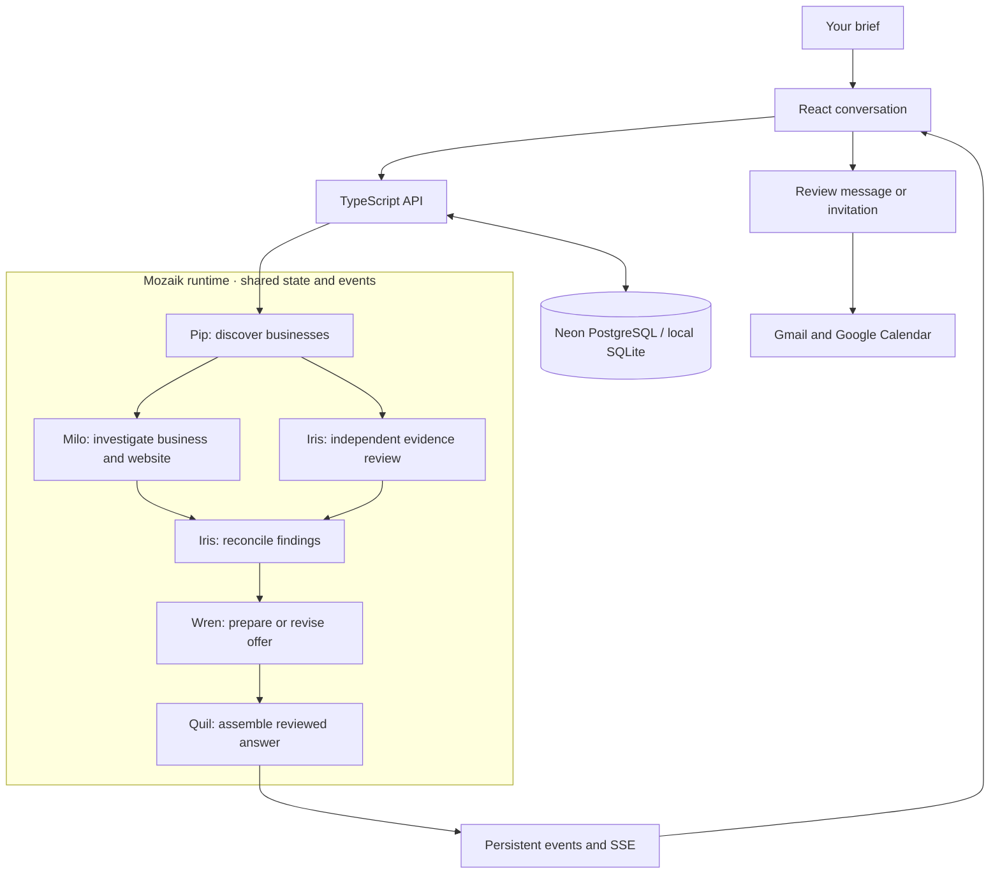

<p align="center">
  
</p>

<h1 align="center">Quil</h1>

<p align="center"><strong>Your next client. Already in sight.</strong></p>

<p align="center">
  A collaborative AI sales crew for freelancers and small agencies.<br />
  Find relevant businesses, investigate opportunities, and turn the evidence into a tailored first hello.
</p>

<p align="center">
  <a href="https://quil-xx.vercel.app/">Live app</a> ·
  <a href="#getting-started">Getting started</a> ·
  <a href="#how-quil-works">How it works</a> ·
  <a href="#architecture">Architecture</a> ·
  <a href="docs/VERCEL-SETUP.md">Deployment</a> ·
  <a href="#license">License</a>
</p>

<p align="center">
  
  
  
  
</p>
<p align="center">
  
  
  
  
</p>

---

## Contents

- [Overview](#overview)
- [How Quil works](#how-quil-works)
- [Meet the crew](#meet-the-crew)
- [Architecture](#architecture)
- [Technology stack](#technology-stack)
- [Getting started](#getting-started)
- [Configuration](#configuration)
- [Research and evidence](#research-and-evidence)
- [Offers and outreach](#offers-and-outreach)
- [API reference](#api-reference)
- [Development and validation](#development-and-validation)
- [Deployment](#deployment)
- [Repository structure](#repository-structure)
- [Documentation](#documentation)
- [Data handling](#data-handling)
- [Contributing](#contributing)
- [License](#license)
- [Third-party notices](#third-party-notices)

## Overview

Quil helps freelancers and small agencies turn prospecting into a focused conversation. Describe the service you offer, the businesses you want to reach, and the location. A five-agent crew finds prospects, investigates their websites and booking flows, reviews the evidence, and prepares a tailored offer you can edit.

The crew works through **Mozaik**, sharing findings and responding when another agent discovers something that changes the pitch. The conversation brings their work together into one answer, with source records, introductions and next steps available alongside each opportunity.

| Capability | What it does |
| --- | --- |
| Conversational brief | Collects your service, target business category and location, asking for missing details as needed. |
| Contextual AI chat | Understands casual follow-ups and corrections using recent messages and your recorded research, with one bounded model request per turn. |
| Business discovery | Finds relevant businesses through public search results, business listings and social profiles. |
| Website investigation | Checks listed website pages, booking links and public email links. |
| Independent review | Cross-checks findings, reconciles conflicting evidence and revises or withdraws unsupported pitches. |
| Tailored offers | Prepares an editable rationale, proposed scope, commercial terms to complete and a personal introduction. |
| Gmail outreach | Previews and sends messages through your connected Gmail account after approval. |
| Follow-ups | Prepares day-3 and day-7 messages and checks the conversation for replies before sending. |
| Reply assistance | Reads the selected conversation, identifies the latest reply and prepares a reviewed response. |
| Offer boundaries | Handles counteroffers within your quote, minimum price, scope and delivery terms. |
| Meetings | Suggests times from your calendar, prepares an agenda, creates approved invitations and checks attendee responses. |
| Private workspaces | Keeps research, saved opportunities and Google connections with their signed-in account. |
| Saved prospects | Saves and removes opportunities, preserves edited drafts and evidence across sessions, and exports CSV. |
| Live collaboration | Shows agent activity as it happens, with pause, resume, cancellation and refresh recovery. |

## How Quil works

1. **Describe your work.** Tell Quil what you offer and who you want to work with. For example: “I build booking websites. Find hairdressers in Manchester.”
2. **Let the crew investigate.** Pip finds businesses. Milo investigates them while Iris independently reviews the available records.
3. **Review the opportunity.** Quil presents the strongest supported finding. Expand the evidence to inspect source links, observations and the reasons other prospects were set aside.
4. **Shape the offer.** Edit the introduction, proposed scope, follow-up messages and meeting agenda.
5. **Make contact.** Connect Gmail and Google Calendar, confirm the business email, and review the exact message before approving delivery.
6. **Keep the conversation moving.** Review eligible follow-ups, check for replies and prepare a meeting invitation for an agreed time.

Open the [live workspace](https://quil-xx.vercel.app/#/workspace) and choose **Or try a little example** to explore the workflow with fictional businesses. Try limited live chat and research before connecting Gmail. Sign in with Google to keep saved opportunities with your account; connect Gmail to continue beyond the preview allowance. Use the envelope button to connect Gmail and Calendar.

## Meet the crew

| Agent | Role | Responsibility |
| --- | --- | --- |
| **Quil** | Lead | Coordinates the crew and assembles the final recommendation. |
| **Pip** | Scout | Discovers businesses matching the brief and collects initial sources. |
| **Milo** | Researcher | Investigates each business, its listed website and booking options. |
| **Iris** | Reviewer | Checks evidence independently and reconciles the team's findings. |
| **Wren** | Writer | Develops the offer, introduction, follow-ups and meeting agenda. |

Each character's movement and contribution follows the mission's actual progress. You can pause, continue or cancel a search from the conversation.

## Architecture



The backend uses `@mozaik-ai/core@4.2.0-beta.18`: runtime participants, shared state, message-triggered situation handlers and agent loops. Milo and Iris work concurrently. Iris reviews again when both investigations are available, allowing a newly discovered website or booking link to change the recommendation before publication. Wren's offer follows the reviewed evidence.

The API persists mission snapshots, events, controls, accounts, approvals and spending reservations. The browser receives progress through **Server-Sent Events** and reconnects to the same mission after a refresh. PostgreSQL transactions coordinate work across Vercel function instances.

Optional **Mozaik Cloud** integration provides a hosted research trace using selected execution metadata. Pair a local machine with `npm run cloud:pair`, or configure a project key for the hosted application. See [Cloud setup](docs/VERCEL-SETUP.md#optional-mozaik-cloud-for-the-demo).

## Technology stack

| Area | Technology |
| --- | --- |
| Application | React 19, TypeScript 7, Vite 8 |
| Interface | Custom CSS, SVG agent characters, Three.js particle scene |
| Typography | Self-hosted Departure Mono display headings and proportional system sans-serif text |
| Agent coordination | Mozaik Core 4.2.0-beta.18 |
| Model inference | GPT-6 Luna through the OpenAI Responses API |
| Discovery | Serper search and bounded public website checks |
| Backend | Node.js 24, TypeScript, JSON endpoints and SSE |
| Persistence | Neon PostgreSQL; SQLite for local development and fixtures |
| Accounts | Google OpenID Connect and private session cookies |
| Outreach | Gmail API and Google Calendar API |
| Delivery | Vercel Functions and static frontend hosting |
| Validation | Node test runner, TypeScript, Oxlint and Chromium DevTools Protocol |

## Getting started

### Requirements

- **Node.js 24.x** and npm.
- Git.
- An installed Chromium browser for browser checks.

### Install and run

```sh
git clone https://github.com/ELLA0VICTOR/quil.git
cd quil
npm ci
npm run dev:all
```

Open **http://localhost:5173**. The command starts Vite and the API together; Vite proxies `/api` to `127.0.0.1:8787`. On Windows, use `npm.cmd` if PowerShell blocks the npm shim.

The initial configuration runs the crew with a reproducible fictional dataset. Choose **Try now → Or try a little example** to explore research, evidence review, editable offers and saved prospects. This example runs Mozaik's coordination without provider credentials.

### Connect services

Copy `.env.example` to `.env`, then configure your services:

1. Add an OpenAI API key and a Serper API key.
2. Set `QUIL_MODE=live` and `QUIL_ENABLE_LIVE=true`.
3. Configure the ordinary Google sign-in client using the [account guide](docs/ACCOUNTS.md).
4. Configure the separate Gmail/Calendar agent client using the [Google connection guide](docs/GOOGLE-SETUP.md).
5. Restart the API, sign into Quil and enter your research brief.

Users sign in and authorize their own Google connection from Quil. Application credentials are configured once by the developer.

## Configuration

Local development loads `.env`; hosted functions read their environment from Vercel. [.env.example](.env.example) contains the configuration template.

| Variable | Purpose |
| --- | --- |
| `QUIL_MODE` | `fixture` for the reproducible example or `live` for provider-backed research. |
| `QUIL_ENABLE_LIVE` | Enables provider-backed work when set to `true`. |
| `OPENAI_API_KEY` | Server-side OpenAI credential. |
| `OPENAI_MODEL` | Model selection: `gpt-6-luna`. |
| `SERPER_API_KEY` | Server-side search credential. |
| `GOOGLE_SIGNIN_CLIENT_ID`, `GOOGLE_SIGNIN_CLIENT_SECRET` | Ordinary account sign-in client. |
| `GOOGLE_SIGNIN_REDIRECT_URI` | Sign-in callback; local template uses `http://localhost:5173/api/auth/google/callback`. |
| `GOOGLE_CLIENT_ID`, `GOOGLE_CLIENT_SECRET` | Separate Gmail/Calendar agent client. |
| `GOOGLE_REDIRECT_URI` | Agent callback; local template uses `http://127.0.0.1:8787/api/google/callback`. |
| `QUIL_PUBLIC_ORIGIN` | Canonical HTTPS origin; Vercel can derive it from `VERCEL_PROJECT_PRODUCTION_URL`. |
| `QUIL_STORAGE` | `sqlite` for local storage or `postgres` for Neon. |
| `DATABASE_URL` | PostgreSQL connection string; use Neon's pooled connection for Vercel. |
| `QUIL_GOOGLE_TOKEN_KEY` | Base64-encoded 32-byte encryption key, required with PostgreSQL. |
| `QUIL_DATA_DIR`, `QUIL_API_PORT` | Local data directory and API port. |
| `QUIL_ENABLE_MOZAIK_CLOUD`, `MOZAIK_API_KEY` | Optional hosted research traces and private Cloud project key. |

### Usage controls

Model requests reserve their estimated cost transactionally before execution. The ledger persists across restarts and is shared by hosted instances. Search allowances are accounted for separately.

| Setting | Template allowance |
| --- | --- |
| `QUIL_TOTAL_BUDGET_USD` | $1.50 cumulative model allowance |
| `QUIL_RUN_BUDGET_USD` | $0.02 per mission |
| `QUIL_USER_DAILY_BUDGET_USD` | $0.02 per account over a rolling 24 hours |
| `QUIL_MAX_MODEL_CALLS` | 7 per mission |
| `QUIL_MAX_SEARCH_REQUESTS` | 50 cumulative search requests |
| `QUIL_MAX_SEARCH_PER_RUN` | 4 search requests per mission |
| `QUIL_USER_DAILY_SEARCH_REQUESTS` | 20 per account over a rolling 24 hours |
| `QUIL_MAX_ACTIVE_RUNS` | 2 concurrent missions, with 1 per workspace |

The model adapter uses bounded context, structured output, at most 800 output tokens per request and persistent reservations for uncertain outcomes. Public search responses are cached for six hours; model responses are scoped to the account and cached for one hour. Dollar limits track application estimates; provider billing remains with the configured accounts.

## Research and evidence

Quil searches public business records and inspects listed website pages. Each finding retains the source URL, observation and retrieval time. Iris checks the business identity, location and supporting quote, then assigns an **opportunity**, **uncertain** or **ruled-out** decision.

Existing websites and online-booking links influence the proposed offer. When new evidence changes the opportunity, the crew revises or withdraws the pitch. The final response highlights the strongest finding and lets you expand the other decisions.

Website investigation uses bounded HTML retrieval with public-address checks and redirect validation. Saved opportunities retain their evidence, edited introduction and offer; CSV export includes the source records. Questions about an existing result use its recorded evidence.

## Offers and outreach

### Prepare the offer

Open **Tailored offer** on an approved opportunity to review and edit:

- The reason for reaching out and the supporting evidence.
- Suggested project scope and how it fits the existing website or booking flow.
- Pricing and delivery terms for you to complete.
- The introduction, day-3/day-7 follow-ups and meeting agenda.

### Send through Gmail

Connect Gmail and Calendar from the envelope button. Under **Contact & next steps**, confirm the recipient, edit the message and select **Prepare approval preview**. The preview shows the sender, recipient and exact content. **Approve & send message** executes that reviewed action.

Public website email links are offered when available. Follow-ups become eligible on day 3 and day 7, with a fresh review before each send. Quil checks the created Gmail thread for replies and stops the unanswered follow-up sequence when someone responds.

### Continue the conversation

After an introduction is sent, open **The conversation ? Read conversation**. Review the latest messages, enter your scope, currency, quote, minimum price and delivery time, then choose **Prepare a response**. Wren prepares the response and Iris checks its source and price boundaries. **Edit this reply** transfers it into the message composer for your review and approval.

A counteroffer within your limits can be reflected in the proposed fee. Lower offers retain your minimum; requests to stop contact halt further outreach. Before sending, Quil checks that the response still addresses the latest message. Explicit future meeting timestamps can prefill the calendar form for review.

### Arrange a meeting

Choose a time agreed with the prospect or request suggestions from your calendar. Review the attendee, timezone, duration and agenda before approving the invitation. Quil rechecks calendar availability before creation; **Check status** retrieves the attendee's response.

Approval previews expire after 30 minutes. Execution is claimed atomically to handle repeated clicks, and uncertain deliveries are reconciled against provider receipts. Outreach preparation and execution use Mozaik agent loops.

## API reference

The application uses same-origin JSON endpoints under `/api`, with HttpOnly session cookies. Mission reads and controls also require the private run token. Reviewed account and outreach writes use the `X-Quil-Action: review` header; `X-Quil-Workspace` identifies the current workspace.

| Method | Endpoint | Purpose |
| --- | --- | --- |
| GET | `/api/health` | Service mode, storage and provider readiness. |
| GET | `/api/session` | Current workspace and sign-in configuration. |
| POST | `/api/auth/signin` | Start Google account sign-in. |
| GET | `/api/auth/google/callback` | Complete account sign-in. |
| POST | `/api/auth/logout` | End the account session. |
| GET / PUT | `/api/me/saved` | Read or update private saved prospects. |
| POST | `/api/brief` | Extract the research brief and request missing details. |
| POST | `/api/chat` | Answer live conversation, including the limited guest preview using recent messages and owned research, or clarify a new search. |
| POST | `/api/runs` | Create a mission and return its snapshot, token and event URL. |
| GET | `/api/runs/:id` | Retrieve the mission and usage records. |
| GET | `/api/runs/:id/events` | Stream events and replay from a cursor. |
| POST | `/api/runs/:id/{pause,resume,cancel}` | Control an existing mission. |
| GET | `/api/google/status` | Read the workspace's Google connection status. |
| POST | `/api/google/{connect,disconnect}` | Authorize or disconnect Gmail and Calendar. |
| GET | `/api/google/callback` | Complete Google service authorization. |
| GET | `/api/outreach` | Retrieve the workspace's outreach records. |
| POST | `/api/outreach/:id/thread` | Read the selected introduction?s conversation. |
| POST | `/api/outreach/:id/draft-reply` | Prepare a response within user-supplied offer terms. |
| POST | `/api/outreach/prepare` | Persist a message or meeting approval preview. |
| POST | `/api/outreach/slots` | Suggest available meeting times. |
| POST | `/api/outreach/:id/{approve,sync,cancel}` | Execute, reconcile or cancel a prepared action. |

Mission events support `Last-Event-ID` and an `after` cursor. Use the returned `eventsUrl` for streaming and `Authorization: Bearer <run-token>` for snapshot and control requests. A mission has a two-minute execution window, including paused time.

Example fixture request for `POST /api/runs`:

```json
{
  "mode": "fixture",
  "request": "Find cleaning businesses in Manchester that could use a simpler booking website."
}
```

Live research requests include `request`, `category`, `location`, `service` and an optional `limit` of 1–3. Live conversation prepares these fields through the model-backed `/api/chat` endpoint before starting a mission. The free fictional example retains `/api/brief`. See [Conversation](docs/CONVERSATION.md) for history, evidence, ownership and usage controls.

## Development and validation

```sh
npm test
npm run lint
npm run build
npm run test:browser
```

The suites exercise concurrent agent work, evidence corrections, account isolation, approval races, persistent budgets, provider adapters, event replay and refresh recovery. Browser checks cover the conversation, saved drafts, outreach screens, account switching, keyboard interaction and responsive layouts across eleven viewports.

| Command | Purpose |
| --- | --- |
| `npm run dev:all` | Start the local frontend and API together. |
| `npm run dev` | Start Vite separately. |
| `npm run dev:api` | Start the API with hot reload. |
| `npm run start:api` | Start the API without file watching. |
| `npm run demo:api` | Exercise the running fixture API. |
| `npm run demo:api -- --save-trace` | Save a reproducible fixture execution trace. |
| `npm run check:api` | Type-check the backend. |
| `npm run test:api` | Run backend and shared behavior tests with injected providers. |
| `npm run build` | Type-check the application and build `dist/`. |
| `npm run preview` | Serve the compiled frontend locally. |
| `npm run test:browser` | Run isolated fixture API and browser checks. |
| `npm run cloud:pair` | Pair this machine with Mozaik Cloud. |

The browser suite uses installed Chrome; set `QUIL_QA_BROWSER` to select another Chromium executable. It starts an isolated fixture API on port 8788 and a preview on port 4174. A real-PostgreSQL integration suite can be run separately against a configured database; it creates and removes its own isolated test schema. See [verification details](docs/vercel-neon-check.md).

## Deployment

Quil runs on **Vercel with Neon PostgreSQL**. The frontend and API share one origin. `api/[...path].ts` handles API requests; `vercel.json` routes nested API paths and configures the function's execution window. Background research uses `waitUntil`, while snapshots, events, controls and usage reservations live in PostgreSQL.

| Vercel setting | Value |
| --- | --- |
| Framework | Vite |
| Node.js | 24.x |
| Install command | `npm ci` |
| Build command | `npm run build` |
| Output directory | `dist` |

Configure the server environment in Vercel, register the production callbacks on the two Google OAuth clients, and verify `/api/health`. The sign-in callback is `/api/auth/google/callback`; the Gmail/Calendar callback is `/api/google/callback`. Google projects in Testing use the configured test-user audience.

Follow the [Vercel and Neon guide](docs/VERCEL-SETUP.md) for environment import, encrypted token storage, callback setup and Cloud tracing.

## Repository structure

```text
quil/
├── api/                    Vercel function entry point
├── docs/                   Setup guides, execution traces and verification records
├── public/                 Feather icon, fonts, font licenses and privacy notice
├── scripts/                Development tools, browser checks and database migration
├── server/
│   ├── engine.ts           Mozaik agents, shared state and mission coordination
│   ├── providers.ts        Model, search and fixture providers
│   ├── evidence.ts         Source checks and opportunity review
│   ├── website.ts          Public website investigation
│   ├── accounts.ts         Google sign-in and workspace sessions
│   ├── google.ts           Encrypted Google connections and API transport
│   ├── outreach.ts         Approval previews, messages and meetings
│   ├── store.ts            Persistent missions, ownership, events and budgets
│   ├── database.ts         PostgreSQL and SQLite adapters
│   ├── cloud.ts            Optional Mozaik Cloud trace bridge
│   ├── http.ts             API routes and event streaming
│   └── tests/              Backend, provider and coordination tests
├── shared/                 Mission, account, offer and outreach types
├── src/
│   ├── components/         Agent characters, particle scene and conversation UI
│   ├── hooks/              Missions, accounts and saved opportunities
│   ├── lib/                API clients, event state and follow-up handling
│   ├── pages/              Landing page and crew workspace
│   └── styles/             Theme and responsive layouts
├── .env.example            Server configuration template
├── vercel.json             Hosting and API routing configuration
└── LICENSE                 MIT license
```

## Documentation

| Guide | Contents |
| --- | --- |
| [Accounts](docs/ACCOUNTS.md) | Google sign-in, private workspaces and account configuration. |
| [Gmail and Calendar](docs/GOOGLE-SETUP.md) | OAuth setup, permissions and the outreach workflow. |
| [Replies and offer terms](docs/REPLIES.md) | Conversation reading, bounded counteroffers and meeting handoff. |
| [Vercel and Neon](docs/VERCEL-SETUP.md) | Production hosting, environment variables and callbacks. |
| [Deployment verification](docs/vercel-neon-check.md) | PostgreSQL, Google transport and deployed-browser checks. |
| [Outreach verification](docs/outreach-check.md) | Approval, delivery and calendar test coverage. |
| [Fixture trace](docs/fixture-trace.json) | Recorded agent timing, overlap and pitch revision. |
| [Live research trace](docs/live-run-trace.json) | Provider-backed research execution metadata. |
| [Hackathon entry](docs/SUBMISSION.md) | Freestyle track context and evaluation references. |

## Data handling

Research, saved prospects, Google credentials and outreach records are scoped to the signed-in account. Sessions use HttpOnly, SameSite cookies, with Secure cookies on the hosted app. Run tokens and session tokens are stored as hashes. Google authorization uses single-use state, nonce and PKCE.

Google credentials are encrypted server-side with account-bound authenticated encryption. Gmail thread checks retrieve reply metadata for Quil?s conversations. Opening a conversation reads bounded message text; requested intent analysis shares selected reply text with OpenAI. Minimum prices remain in local application logic. Provider keys, databases, private captures and local runtime artifacts are excluded from Git. Keep service credentials in server environment variables.

The public [privacy notice](https://quil-xx.vercel.app/privacy.html) describes stored information and provider interactions.

## Contributing

1. Create a branch for your change.
2. Keep source provenance, account ownership and reviewed outreach intact.
3. Test changes to agent coordination, integrations, permissions or persistence with fixture or injected providers.
4. Run the relevant validation commands and describe the resulting behavior in your pull request.
5. Keep credentials and private runtime data outside the repository.

## License

Quil is released under the [MIT License](LICENSE).

Copyright © 2026 Quil contributors.

## Third-party notices

- [Departure Mono](https://departuremono.com/) by Helena Zhang — [SIL Open Font License 1.1](public/fonts/LICENSE.txt).
- [SUSE Mono](https://github.com/SUSE/suse-font) — [SIL Open Font License 1.1](public/fonts/SUSE-Mono-OFL.txt).
- React, Vite, Three.js and Mozaik retain their respective MIT licenses.
