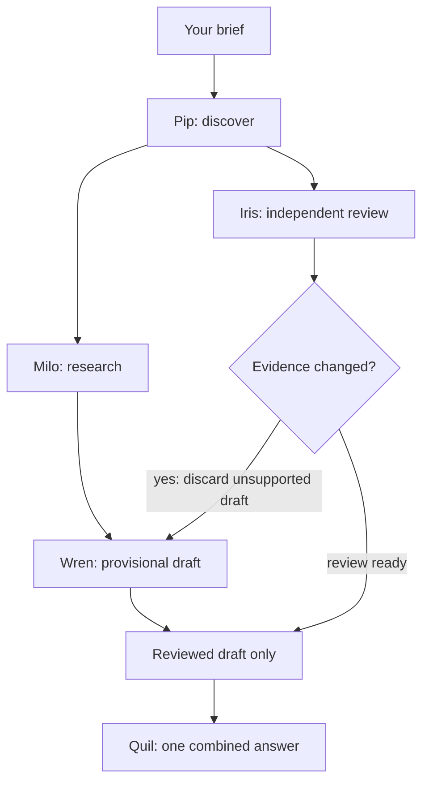

# Quil

**Your next client. Already in sight.**

A conversational sales crew for freelancers and small agencies: discover relevant businesses, investigate their website situation, review evidence, and prepare a thoughtful introduction.

## Current implementation

The frontend is built with React, TypeScript, Vite and Three.js. A separate local TypeScript backend now runs the crew through Mozaik:

- Brisk automatic rotation and a repeating 5.2-second cube/tree cycle, cursor-directed rotation and particle distortion, a star field, an unobstructed rippling floor and a reflection. No manual shape controls or orbital rings.
- An open landing-page layout with fine dividers, an animated SVG crew, and working internal footer navigation.
- A conversational app led by Quil, with Pip (scouting), Milo (research), Iris (review) and Wren (writing).
- Tiny original SVG characters walk between positions, exchange observations and react to the current example phase. No emoji, sprite-sheet download or generated image is used.
- Plain-language input and teammate introductions. Server events update five colour-matched contributions in a connected layout, converging into one shared result rather than a long stream of status messages.
- Pause/resume, one primary opportunity, expandable reasons for the businesses set aside, inline evidence and editable drafts.
- Browser-local saved prospects, CSV export, clipboard copying and keyboard-accessible saved/about panels.

**The chat is connected to the backend.** `src/hooks/useCrewRuns.ts` consumes server events through `src/lib/api.ts`; agent activity, corrections, sources, introductions and the single final answer come from the run. There is no timed frontend mission script or local sample-data fallback. Default fixture mode still uses fictional records without paid inference.

**Development and review are local-only. Do not publish, push for hosting, or redeploy without the owner's explicit instruction.**

## Run

Use Node.js 24+ and npm:

```sh
npm install
npm run dev
```

Start the API as described below, then open the URL Vite prints. Select **Try now** to meet the crew. **Or try a little example** explicitly requests a free backend fixture run, including when the server is configured for live use. Ordinary chat briefs follow the server's configured mode. Tap a character to hear their introduction. The pause button pauses server publication; **Continue the search** resumes it. **Cancel search** aborts it, and **New conversation** cancels unfinished work before clearing the view.

The current run reconnects after a refresh using a tab-scoped run token. This resumes/replays the same run rather than submitting a new one. Saved businesses include their actual returned sources and edited introductions, persist in this browser and can be exported as CSV. Server failures show an error; they never substitute a frontend demonstration.

```sh
npm run build
npm run preview
```

Production output is in `dist/`. Hash routing keeps `/#/workspace` compatible with static hosting.

## Backend package

Start the API in a second terminal. No key is needed for its default fixture mode:

```sh
npm run start:api
npm run demo:api
```

Run the second command in another terminal while the API is running. For automatic backend reloads, use `npm run dev:api`. The API binds to `127.0.0.1:8787`; Vite proxies `/api` locally. No deployment or external publication is performed.

- `server/engine.ts`: five Mozaik agents, shared runtime state, event-driven coordination and actual agent loops.
- `server/providers.ts`: deterministic fixture provider, bounded GPT-6 Luna Responses adapter and cached Serper search adapter.
- `server/store.ts`: SQLite run records, event replay, conservative spending reservations and cache.
- `server/http.ts`: run creation, authenticated run access, SSE, pause/resume and cancellation.
- `shared/mission.ts`: browser/server protocol. Run access tokens are returned only when creating a run; only their hashes are stored.

Mozaik is pinned to **4.2.0-beta.18**. This published package uses `defineRuntime`, `createSpace`, runtime participants, and `defineAgentModule` / `createLoop` / `runLoop`. Its published API differs from examples on the development branch; implementation follows the installed package.



Milo and Iris start from the same Mozaik message and run independently. Wren may draft while the review is still running. If Iris finds contrary evidence, shared state removes unsupported provisional drafts and only Wren revises. Quil cannot publish the outcome until review and the current draft revision agree. Provisional drafts never appear in the final result.

Fixture mode runs these **real Mozaik loops against fictional data**, without model or search calls. It does not claim live AI inference. [The recorded fixture trace](docs/fixture-trace.json) contains actual start/finish times, loop transitions, research/review overlap and the correction. Regenerate it using `npm run demo:api -- --save-trace`.

### API

| Method | Route                  | Purpose                                                                   |
| ------ | ---------------------- | ------------------------------------------------------------------------- |
| GET    | `/api/health`          | Mode and readiness; no secret values                                      |
| POST   | `/api/brief`           | Free brief extraction and clarification; never starts model/search work   |
| POST   | `/api/runs`            | Start one mission; returns snapshot, access token and event URL           |
| GET    | `/api/runs/:id`        | Snapshot and usage; Bearer run token required                             |
| GET    | `/api/runs/:id/events` | SSE; token query or Bearer token; supports Last-Event-ID / `after` replay |
| POST   | `/api/runs/:id/pause`  | Pause before the next step/result publication                             |
| POST   | `/api/runs/:id/resume` | Continue the same run                                                     |
| POST   | `/api/runs/:id/cancel` | Abort ongoing provider requests; no automatic retry                       |

Controls require the Bearer run token. A pause allows already-issued provider calls to finish, but holds their publication and subsequent work until resumed. Runs time out after two minutes, including paused time. One active mission and up to three businesses are allowed. Unknown tokens and runs return the same response. Disconnecting SSE does not restart or cancel the run; reconnect to replay events. An API restart marks unfinished runs failed instead of replaying paid work.

Fixture request:

```json
{
  "request": "Find cleaning businesses in Manchester that could use a simpler booking website."
}
```

Live run requests must supply `category`, `location`, and `service`; optional `limit` is 1–3. The chat first calls `POST /api/brief`, a free deterministic parser that extracts supported phrases or returns a clarification question. Replies retain the previous answers. No model/search request starts until the required details are present. This first version targets evidence-supported website/booking-flow prospecting; unfamiliar phrasing asks for clarification rather than guessing.

### Live configuration and cost limits

Copy `.env.example` to the ignored `.env` file and edit it locally. Never put keys in `VITE_` variables or paste them into the chat.

Live execution requires **both** `QUIL_MODE=live` and `QUIL_ENABLE_LIVE=true`, plus `OPENAI_API_KEY` and `SERPER_API_KEY`. No live requests have been made during implementation; account access and real-data quality still require a small integration run with the owner's keys.

The [official GPT-6 Luna model page](https://developers.openai.com/api/docs/models/gpt-6-luna) lists the selected model and pricing. The adapter uses the Responses API, `store: false`, standard service tier, reasoning `none`, at most 800 output tokens, no built-in paid tools, bounded inputs, timeouts and no automatic retries. It does not use Mozaik's unrestricted default model transport.

Default safeguards:

- **$0.50 total / $0.02 per run** in conservative model-cost estimates, reserved transactionally in SQLite **before** each request; up to seven model requests per run.
- Input cost counted at the standard cache-write ceiling, without assuming discounts. Prices are pinned to the published GPT-6 Luna standard rates checked on 29 October 2026. These are application estimates, not an account-wide billing limit; review pricing before later reuse.
- Incomplete or failed calls with known usage are charged to the ledger. Ambiguous network failures and interrupted calls retain the full reservation. Restarting the server does not reset spending.
- **50 total / four per run** Serper requests. Search credits/costs are separate from the OpenAI dollar ceiling. Failed searches still count against the allowance.
- Cached search records for six hours and model responses for one hour. Only relevant evidence is sent to the writing agent.

`.quil-data/` holds the ignored ledger and traces. Deleting it also deletes application spending history, so do not delete it to resolve a request failure. API run tokens and local origin checks are for local development; public hosting requires an appropriate user-access layer first.

Search snippets are not website uptime checks. Missing website fields remain unknown. A matching website reference prevents a missing-website pitch; an inconclusive result stays inconclusive. Sources and observation times accompany every decision. No email, message or payment is sent.

### Backend verification

```sh
npm run check:api
npm run test:api
```

Tests cover real Mozaik concurrency and correction, pause/resume/cancel, SSE replay and access checks, persistent competing spending reservations, no automatic model retries, caching, search quotas, restart recovery, and a complete live-adapter workflow using mocked external transports. Tests consume no provider credits.

The hackathon requires Mozaik and concurrent agents. The execution trace records the actual coordination, and the connected interface follows those events.

## Visual implementation

`src/components/ParticleScene.tsx` generates the scene in code, lazy-loads Three.js, limits pixel ratio and mobile particles, and pauses offscreen or when the document is hidden. It uses no video, image sequence, external 3D model or generated image. The feather SVG is original.

## Browser checks

Start the production preview on port 4173, then run:

```sh
node scripts/browser-qa.mjs
```

The script uses an installed Chrome browser through the DevTools Protocol; no browser is downloaded. Set `QUIL_QA_BROWSER` for another Chromium executable. It checks WebGL and automatic morphing, the removal of the old controls/cards, desktop/mobile overflow, crew introductions, typed prompts, mission pause/resume, example results, inline evidence/drafts, saving, opportunity filtering, saved state after a new conversation, composer visibility and mobile navigation. Runtime errors and compact JPEG screenshots go into ignored `.sites-runtime/qa/`.

Connected-flow checks also compare the displayed answer with the server snapshot, verify that refresh preserves the run without a second POST, retain saved draft edits, cancel real server work, and confirm an outage shows an error instead of sample results. Both the API and the preview server must be running.

## Credits

- [Three.js](https://threejs.org/) — MIT.
- [Departure Mono](https://departuremono.com/) by Helena Zhang — SIL Open Font License 1.1, included in `public/fonts/LICENSE.txt`.
- [SUSE Mono](https://github.com/SUSE/suse-font) — locally hosted variable font for navigation and supporting text; SIL Open Font License 1.1, included in `public/fonts/SUSE-Mono-OFL.txt`.
- React and Vite are retained from the supplied starter.

Quil's original code is MIT licensed; third-party assets retain their licenses.
